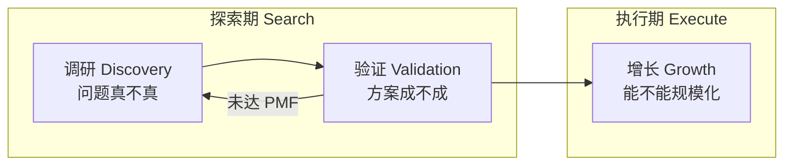
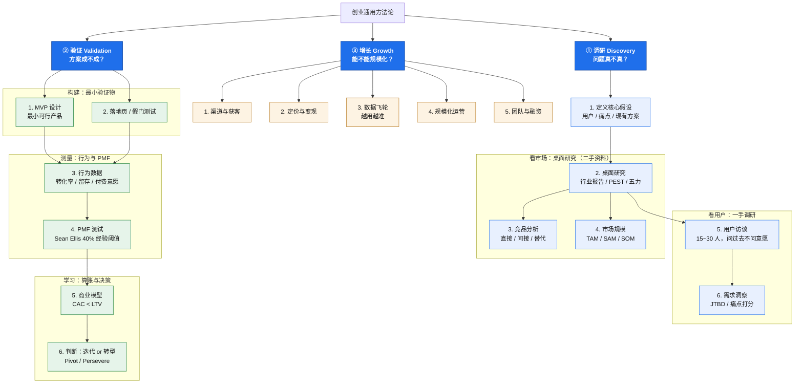

# 创业通用方法论

> 文档类型：方法论 / 研究结论
> 适用场景：早期创业项目
> 最后更新：2026-10-11

## 目录

- 1. 摘要与核心结论
  - 1.1 核心结论表
  - 1.2 总览图
- 2. 背景、问题与范围
- 3. 三阶段结构（核心框架）
  - 3.1 各阶段说明
- 4. 关键规则与常见误区
- 5. 阶段对比与证据强度
  - 5.1 三阶段速览
  - 5.2 证据强度对比
- 6. 风险、边界与待定项
- 7. 实施与验证计划
- 8. 验收标准与附录
  - 8.1 验收标准
  - 8.2 术语附录

## 1. 摘要与核心结论

创业过程可归纳为三大阶段：**调研（Discovery）→ 验证（Validation）→ 增长（Growth）**。前两者合称**探索期（Search）**，目标只有一个——找到**产品市场契合（PMF, Product-Market Fit）**；达成 PMF 后才进入**执行期（Execute）**，做规模化与增长。

本文件给出这三步的结构、各自的细分动作、判定标准与常见误区，作为后续项目的通用方法论参考。核心主张是：创业不是「执行一个大计划」，而是**不断降低不确定性的循环**。

需要明确的边界：本文汇总的是**方法论结论与业界经验法则**，不含任何针对特定项目的实测数据。文中出现的量化阈值（如 40%、访谈 15~30 人）均为**常用经验参考值，属待验证项**，不是已验证结论。本文件不覆盖具体行业（如港校申请）的专项调研内容。

### 1.1 核心结论表

| 结论 / 要点 | 内容与依据 | 适用边界 |
| --- | --- | --- |
| 创业可归为三个阶段 | 调研 → 验证 → 增长；前两者为探索期，目标为 PMF | 通用早期创业框架 |
| 调研 ≠ 验证 | 调研产出「认知」（用户说），验证产出「行为」（用户做） | 阶段划分的核心依据 |
| 两阶段是循环而非串行 | 调研 → 形成假设 → 验证 → 得到数据 → 再调研，直到 PMF | 循环终止条件为 PMF |
| 找 PMF 只发生在探索期 | 增长/规模化属执行期，应在 PMF 达成后进行 | 顺序不应颠倒 |
| 最大陷阱 | 只做调研（他人评价）即视为验证通过 | 以真实付费/行为证据为准 |

> 表中「结论」为方法论层面的结论或经验法则；「依据」来自公认创业框架（精益创业、JTBD 等）与本文件归纳，非本项目的实测数据。

### 1.2 总览图

## 2. 背景、问题与范围

### 已知背景 / 事实

- 面向早期创业者，需要一个可执行、可对照的通用方法论框架。
- 已有共识框架：精益创业（Build-Measure-Learn）、设计思维、JTBD、PMF（Sean Ellis 测试）等均为业界公认方法。

### 目标 / 待回答问题

1. 创业过程能否被结构化为可执行的阶段？ → 能，见第 3 章。
2. 各阶段的核心问题与关键动作分别是什么？ → 见第 3、4 章。
3. 各阶段用什么标准判定「可以进入下一阶段」？ → 见第 5 章。

### 非目标 / 范围外

- 不针对具体行业（如港校申请）展开专项调研。
- 不覆盖融资条款、股权结构、法务合规等专项内容。
- 不提供已验证的量化指标或业绩承诺。

## 3. 三阶段结构（核心框架）

### 3.1 各阶段说明

- **① 调研（Discovery）**：解决「问题真不真」。顺序为「先立假设 → 再看市场（桌面研究，含竞品分析与市场规模）→ 再看用户（访谈 → 洞察）」；一手调研排在二手资料之后。
- **② 验证（Validation）**：解决「方案成不成」。按「构建 → 测量 → 学习」三段推进：做最小验证物、测行为与 PMF、算账并决策。
- **③ 增长（Growth）**：解决「能不能规模化」。在 PMF 成立后做渠道、变现、数据飞轮、规模化与团队融资。

> **图例**：`① 调研`、`② 验证` 的节点编号表示**建议的先后依赖**，箭头即真实前置关系；`③ 增长` 的 5 项属**并列主题**，编号仅为建议关注顺序，不代表硬性依赖。

## 4. 关键规则与常见误区

1. **调研 ≠ 验证**：调研是用户「说」，验证是用户「做」；只有行为与付费证据才算强证据。
2. **不是串行两步，而是循环**：调研 → 假设 → 验证 → 数据 → 再调研，循环终止条件是 PMF。
3. **先验证需求，再做产品**：多数失败源于「做了一个没人要的东西」。
4. **警惕伪需求**：「朋友说这想法不错」不是验证信号。

## 5. 阶段对比与证据强度

### 5.1 三阶段速览

| 阶段 | 核心问题 | 主要产出 | 判定标准 |
| --- | --- | --- | --- |
| ① 调研 | 问题真不真？ | 认知、需求清单 | 有明确的高频高强痛点 |
| ② 验证 | 方案成不成？ | 行为数据、付费证据 | 达到 PMF（经验阈值见 6 章） |
| ③ 增长 | 能不能规模化？ | 增长曲线、单位经济 | CAC < LTV，可持续盈利 |

### 5.2 证据强度对比

| 手段 | 属于 | 产出 | 证据强度 |
| --- | --- | --- | --- |
| 访谈 / 问卷 / 桌面研究 | 调研 | 认知 | 弱（会说谎、会客气） |
| MVP / 落地页 / 收费测试 | 验证 | 行为与数据 | 强（用脚投票） |

## 6. 风险、边界与待定项

| 项 | 类型 | 说明 |
| --- | --- | --- |
| 40% 阈值 | 经验法则 / 待验证 | Sean Ellis 测试常用参考值，需在本领域自行验证 |
| 访谈 15~30 人 | 经验法则 | 常见区间，非硬性数量；以信息饱和为准 |
| 三阶段线性顺序 | 简化结论 | 实际中阶段可能重叠，尤其增长期仍需局部验证 |
| 团队 / 融资时点 | 待定项 | 依赖 PMF 与单位经济，无固定时间点 |

## 7. 实施与验证计划

按「探索期优先」给出建议顺序（时间仅为规划，非承诺）：

1. **Phase 0 需求验证**：完成用户访谈与竞品拆解，输出需求清单。
2. **Phase 1 伪 AI MVP**：搭规则引擎原型，前端一屏完成「输入 → 定位结果」。
3. **Phase 2 数据闭环**：回收真实申请结果形成标签数据。
4. **Phase 3 模型迭代**：数据量达标后引入模型，再进入增长阶段。

## 8. 验收标准与附录

### 8.1 验收标准

- 能回答第 2 章的 3 个待回答问题。
- 文中所有量化阈值均标注为经验法则或待验证项，无未标注的绝对结论。

### 8.2 术语附录

| 术语 | 含义 |
| --- | --- |
| PMF | Product-Market Fit，产品市场契合 |
| MVP | Minimum Viable Product，最小可行产品 |
| JTBD | Jobs To Be Done，用户「雇佣」产品完成的任务 |
| TAM / SAM / SOM | 总市场 / 可服务市场 / 可获得市场 |
| CAC / LTV | 获客成本 / 用户终身价值 |
| PEST / 五力 | 宏观环境分析 / 波特五力竞争分析 |
| Pivot / Persevere | 转型 / 坚持 |
