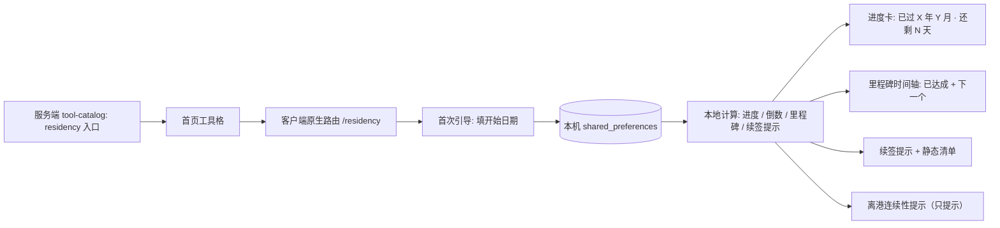

# 永居规划功能设计与技术方案

> 状态：v1、v2 与 v3 已实现（本机计算 + 本地存储、进度与倒数、里程碑时间轴与达成提示、离港标记与其连续性提示、续签多级提示与静态清单、首页入口与四语种、本地渲染并分享的旅程卡片）。

## 目录

- [1. 方案摘要](#1-方案摘要)
- [2. 背景、用户与范围](#2-背景用户与范围)
- [3. 设计决策记录](#3-设计决策记录)
- [4. 页面与交互设计](#4-页面与交互设计)
- [5. 计算口径与语义契约](#5-计算口径与语义契约)
- [6. 数据模型与本地存储](#6-数据模型与本地存储)
- [7. 文案与多语言](#7-文案与多语言)
- [8. 服务端改造](#8-服务端改造)
- [9. 客户端改造与实施顺序](#9-客户端改造与实施顺序)
- [10. 分期计划](#10-分期计划)
- [11. 风险、边界与待确认项](#11-风险边界与待确认项)
- [12. 验收要点](#12-验收要点)

## 1. 方案摘要

`永居规划` 面向**已经开始累积「通常居住香港连续七年」这一过程的在港人士**，提供一个**纯本机、无账号、无推送**的自用进度工具：用户只填一个「开始累积日期」（可选填签证类型与签证到期日），App 负责按日历计算已过时长、距离七年的倒数、逐月／逐年里程碑，并在 App 内呈现仪式感与续签提示。

产品是**规划参考，不是资格判定**。任何界面文案都不得输出「符合／不符合永居资格」的结论。

### 1.1 关键结论

| 维度 | 已定方案 | 边界 |
| --- | --- | --- |
| 定位 | 记录型进度工具：进度 + 倒数 + 里程碑 + 续签提示 | 不做资格判定、不做申请代办 |
| 输入 | 开始日期（必填，首次引导填写）；签证类型、签证到期日、离港时段（均可选） | 不做每日打卡、不做逐次出入境记录、不做用户撰写的旅程记录 |
| 进度 | 纯日历时间（开始日期 → 开始日期 + 7 年，按自然日历加年） | 离港标记**只提示、不扣减** |
| 里程碑 | 每满一月 + 每满一年 + 「还剩 xxx」倒数；时间轴为「已达成 + 下一个待达成」的滚动窗口 | 不一次铺开 84 个月节点 |
| 仪式感 | 仅 App 内：里程碑称号 + 轻动效 + 下次打开时提示「你已跨过第 N 个月／第 N 年」；旅程卡片在本地渲染为 PNG，由用户主动分享 | 无远程推送；分享不经服务端、无上传 |
| 续签 | 手填到期日 → 90／60／30 天多级 App 内提示 + 按签证类型的静态清单 | 不自动推算到期日 |
| 数据 | 纯本地（`shared_preferences`），无账号、无用户表、数据不出设备 | 换机迁移后续以导出／导入解决 |
| 文案 | 客户端内置静态文案（四语种） | 规则变化需随 App 版本更新 |
| 入口 | 沿用服务端已登记的 `residency` 工具（`feature_id=residency`） | 仅需一次描述文案 migration |

### 1.2 端到端链路



图中「本机计算」不依赖任何服务端接口；除首页工具目录外，本功能无网络依赖。

## 2. 背景、用户与范围

原[产品需求与规划文档](产品需求与规划文档.md)第 3 节「模块二：新港人身份与续签计算器」提出永居／续签「算日子」。本次讨论后收敛为**以记录与仪式感为主、续签提醒为辅**的本地工具，而非一个输出资格结论的判定器。

**目标用户**：已经开始累积七年居港期、并希望「看见自己一步步靠近」的人。不按签证类型切分人群——签证类型仅作为个人背景字段记录。特别地，**港深通勤者**是重点场景：他们不会每天记录，但恰恰长期离港，是最容易被「日历进度条」误导的一群人。

**用户目标**：打开即知道「已过多久、还剩多久、走到哪一步」；在达到里程碑时获得「又近一步」的感知；在签证将到期时被温和提醒并看到该准备什么。

**首版范围**：开始日期输入与本地保存；进度与倒数；里程碑时间轴与达成提示；可选离港时段标记（仅提示）；手填签证到期日与多级提示 + 静态清单；四语种；首页入口。

**非目标**：永居资格判定或申请材料代办；自动推算签证到期日；每日／逐次出入境记录；用户撰写的旅程记录（文字／照片）；远程推送通知；跨设备同步或账号体系；桌面 Widget；与服务端算法产物的任何耦合。

**已确认现状**（供实施参考）：`residency` 工具已在服务端 migration `20261012_000002__seed_home_tools.sql`、分组目录 `20261012_000003__create_grouped_tool_catalog.sql` 中登记，标题在 `20261012_000006__shorten_home_tool_titles.sql` 被缩短为「永居规划」；`hkhub_app` 的四个 `*.arb` 已含 `residencyTitle` / `residencyDescription`（当前未在 Dart 代码中被引用）；客户端 `lib/modules/home/presentation/tool_grid.dart` 的 `nativeToolRoutes` 目前只注册 `education` 与 `commute`，`/residency` 页面尚未实现。

## 3. 设计决策记录

本节记录讨论中确定的取舍，供后续复盘；实现与文案不得偏离这些结论。

| 编号 | 决策 | 结论 |
| --- | --- | --- |
| D1 | 目标用户 | 已开始累积七年者；签证类型仅作为背景字段，不据此切分人群 |
| D2 | 产品重心 | 记录与仪式感为主，续签提醒为辅 |
| D3 | 承诺边界 | 规划参考，不做资格判定、不输出「符合／不符合」 |
| D4 | 输入方式 | 仅填开始日期；不做每日／逐次出入境记录 |
| D5 | 里程碑 | 每满一月 + 每满一年 + 「还剩 xxx」 |
| D6 | 隐私与可见性 | 默认私密；分享为可选（后续分期） |
| D7 | 旅程记录 | **不做**（用户撰写的文字／照片内容整体去掉） |
| D8 | 进度口径 | 纯日历时间；离港标记只提示、不扣减 |
| D9 | 离港标记 | 保留为**可选**的离港时段（起止日期，可多条），仅用于连续性提示 |
| D10 | 仪式感触达 | **仅 App 内**，无推送；里程碑称号 + 轻动效 + 下次打开提示 |
| D11 | 数据架构 | 纯本地 `shared_preferences`，无账号、无用户表 |
| D12 | 规则文案 | 客户端内置静态文案 |
| D13 | 入口 | 沿用服务端已存在的 `residency`；描述文案向「记录／历程」倾斜，标题保留「永居规划」 |
| D14 | 首屏层级 | 进度卡在上、里程碑时间轴在下 |
| D15 | 时间轴密度 | 只展示「已达成节点 + 下一个待达成节点」，达成后递进出现（历史可向上回看） |
| D16 | 首次使用 | 引导卡片，填好开始日期后才进入正式界面 |
| D17 | 续签提醒 | 手填到期日；90／60／30 天多级提示 + 按签证类型的静态清单 |
| D18 | 满七年后 | 进度条满格 + 「已满七年，请以官方流程为准」 |
| D19 | 计算基准 | 按日历（同月同日）满月／满年；开始日期当天计入已过时长 |
| D20 | 可编辑性 | 开始日期与签证类型可编辑但需二次确认；离港标记可随时增删改；提供「清空本机数据」 |
| D21 | 首版范围 | v1 主体验（设置 + 进度 + 里程碑 + 入口 + 四语种），v2 离港标记 + 续签提醒，v3 分享卡 |
| D22 | 与通勤模块 | 通勤页加一条轻提示单向引流到永居规划；反向不做 |

## 4. 页面与交互设计

模块建议置于 `lib/modules/residency/`，与 `education` / `commute` 保持同样的 `data/` + `presentation/` 结构。

### 4.1 首次使用与空状态

- 未设置开始日期时，首屏直接呈现**引导卡**：一句产品说明 + 一个日期选择项 + 「开始记录」按钮。填写并提交后才切换到正式界面。
- 引导卡需明确一句边界说明：「本工具帮助你记录与规划，不判定永居资格，请以入境事务处指引为准。」
- 引导卡下方提供一句本地存储说明：「数据只保存在本机。」

### 4.2 主界面结构（进度卡 + 里程碑时间轴）

自上而下：

1. **进度卡（hero）**
   - 主文案：`已过 X 年 Y 月` + `还剩 N 天`（天／月可切换，默认显示天）。
   - 视觉：进度环或进度条，进度比例为「已过自然日 / 七年总自然日」，封顶 100%。
   - 附属信息：开始日期、距离七年目标日的日期（措辞为「预计满七年」而非「可申请日」）。
   - 若设置了签证到期日：在进度卡内以独立行展示「签证到期：YYYY-MM-DD（还剩 M 天）」。
2. **下一个里程碑**：显示最近一个未达成的月／年节点与到达日期。
3. **里程碑时间轴**：默认仅展示「已达成节点 + 下一个待达成节点」（D15）。已达成节点可向上滚动回看；每达成一个新节点，下一次进入时在顶部提示「你已跨过第 N 个月 / 第 N 年」，并配轻动效与节点「称号」（D10）。
4. **续签提示区**（v2）：多级提示 + 展开式静态清单，按签证类型区分。
5. **离港提示区**（v2）：已标记的离港时段列表 + 连续性说明；若存在较长离港，给出**软提示**（措辞见 §5.4）。
6. **设置入口**：编辑开始日期／签证类型／签证到期日，管理离港标记，清空本机数据。

### 4.3 里程碑时间轴的表现

七年 = 84 个月，因此：

- 时间轴以「月」为最小节点，但**不一次渲染全部**；以「已达成 + 下一个」的窗口滚动推进，避免信息过载与仪式感贬值。
- 年节点在视觉上强于月节点（例如年节点带称号与强调色）。
- 达成历史不额外存储：已达成集合由「开始日期 → 当前时间」纯计算得出，时间轴向上滚动即可回看。

### 4.4 仪式感的落地（无用户输入、无推送前提下）

| 机制 | 说明 |
| --- | --- |
| 节点称号 | 月节点如「第七个月」，年节点如「第二年」；满七年给出终态称号 |
| 轻动效 | 打开时若检测到新达成节点，进度卡与对应节点播放一次轻量动效 |
| 跨过提示 | 顶部一次性提示「你已跨过第 N 个月 / 第 N 年」，不重复打扰 |
| 分享卡（v3，已实现） | 用户主动点击「生成旅程卡片」→ 预览 → 「分享」导出 PNG（`share_plus` + `XFile.fromData`）；默认不生成、不上传 |

### 4.5 编辑与清空

- 修改开始日期会重算全部进度与里程碑，需二次确认（`TDAlertDialog`，与 `education` 的清除确认同风格）。
- 签证类型、签证到期日、离港标记可随时增删改。
- 「清空本机数据」调用存储层 `clear()`，同样使用二次确认。

## 5. 计算口径与语义契约

### 5.1 时间基准

- **时区**：一律按 `Asia/Hong_Kong`（UTC+8）判断「今天」。存储为日期字符串 `YYYY-MM-DD`，不含时分。
- **日历口径**（D19）：满月／满年按同月同日推算（例：2026-03-15 起，2027-03-15 为满一年）。不使用「30 天/365 天」的固定天数，避免闰年误差。
- **开始当天计入**已过时长（即开始日期为第 1 天）。

### 5.2 进度与倒数

```
targetDate   = startDate + 7 年（按日历）
elapsed      = 今天 - startDate          // 展示为「X 年 Y 月」
remainingDays = targetDate - 今天         // 展示为「还剩 N 天」
progress     = clamp(elapsedDays / totalDays, 0, 1)
```

- 允许在「天」与「月」之间切换倒数显示；默认为天。
- 不展示「已节省／可提前」等推断性结论。
- 到达或超过 `targetDate` 后（D18）：进度条满格，倒数替换为「已满七年，请以官方流程为准」；不出现任何资格判定措辞。

### 5.3 里程碑判定

- 月节点：`startDate + n 个月`（n = 1..84）。
- 年节点：`startDate + n 年`（n = 1..7），视觉上强于月节点。
- 「下一个里程碑」= 当前时间之后最近的月节点（若恰当年节点则以年节点为准）。
- 达成判定为纯函数，输入「开始日期 + 今天」即可复现，不依赖存储的状态标记。

### 5.4 离港标记（只提示，不扣减）

- 数据结构：`[{ startDate, endDate }]`，`endDate` 可为空表示「仍在离港中」；可多条。
- **绝不参与进度计算**（D8）。仅用于在离港提示区给出说明。
- 说明文案必须包含不确定性：官方要求为「通常居住香港连续七年」，**短期离港一般不影响连续性，但长期或不稳定的离港可能被视作中断，且是否构成中断由入境处按个案判断**。
- 若存在时长较长的离港（本地判定阈值不对外暴露），给一句**软提示**（「请留意连续性，建议以官方指引核实」）；文案中不出现任何天数数字，也不声称存在官方硬性阈值。

### 5.5 续签提示（v2）

- 触发：已填签证到期日时，在剩余 90 / 60 / 30 天进入提示；超过 90 天仅展示剩余天数，不提示。
- 提示仅在 App 内展示（进度卡内的到期行 + 续签提示区），**无远程推送**（D10）。
- 清单：按已记录的签证类型展示静态条目（客户端内置四语种）。清单条目为「通用准备建议」，不得包含「你一定能续签成功」等承诺。
- 不自动推算到期日（D17）：不同计划的年限差异大，自动推算会失真。

## 6. 数据模型与本地存储

### 6.1 数据模型（建议）

```dart
class DepartureMark {
  final String startDate;   // 'YYYY-MM-DD'
  final String? endDate;    // null = 仍在离港中
}

class ResidencyProfile {
  final String? startDate;      // 开始累积日期
  final String? visaType;       // 'ttps' | 'qmas' | 'asmtp' | 'iang' | 'other' | 'none'
  final String? visaExpiryDate; // 可选
  final List<DepartureMark> departures;
}
```

派生值（不落盘，纯函数计算）：`targetDate`、`elapsed`、`remainingDays`、`progress`、里程碑列表、下一个里程碑、续签剩余天数与提示级别。

### 6.2 存储约定

沿用现有模块约定（参考 `education_storage.dart` / `commute_providers.dart`）：

- key：`hkhub.residency.${Uri.encodeComponent(apiBaseUrl)}`，以 API 环境隔离，防止开发环境数据混入生产。
- 结构：`{ "version": 1, "profile": { ... } }`；读取时校验 `version`，不一致或解析失败则返回空档案。
- 上限：序列化字符串设长度上限（参考 `education_storage.dart` 的 200000 字节量级），超限按空处理。
- 清洗：读取时对字段做白名单清洗（日期格式、签证类型枚举、离港时段条数与长度上限），非法字段丢弃而不是抛错。
- 写入：所有写入失败抛 `StateError`，由界面转为「本机保存失败，请重试」提示（与 `education` 一致）。
- 清空：`clear()` 删除该 key；「清空本机数据」入口调用它。

## 7. 文案与多语言

- 模块文案用**模块级 strings 类**（三语回退：简体 / 繁体 / 英文），与 `education_strings.dart`、`commute_strings.dart` 完全一致：

```dart
class ResidencyStrings {
  ResidencyStrings(Locale locale)
      : _index = locale.languageCode == 'en' ? 2
            : locale.languageCode == 'zh' && locale.scriptCode != 'Hant' ? 0 : 1;
  // 粤语（yue-Hant-HK）按既有约定回退到繁体（index 1）
}
```

- 同时更新四个 `lib/app/l10n/*.arb` 的 `residencyTitle` / `residencyDescription`（当前未被 Dart 引用，保持与目录文案一致即可），并重新生成 `lib/app/l10n/generated/`。
- **必须包含的公共文案**：
  - 边界声明：规划参考、不判定资格、以入境处指引为准（可复用现有 `notLegalAdvice` 的措辞风格）。
  - 本地存储说明：数据只保存在本机。
  - 连续性说明与软提示（§5.4）。
- 所有涉及「还剩 X 天」「已过 X 年 Y 月」的文案需支持占位符，并覆盖 `zh-Hans` / `zh-Hant` / `yue-Hant-HK` / `en` 四语种。

## 8. 服务端改造

本功能**不需要新的表、接口或 worker**。唯一改动是把 `residency` 工具的描述文案向「记录／历程」倾斜（D13），标题保留「永居规划」。

建议新增一条 migration，沿用 `20261013_000008__update_commute_tool_copy.sql` 的 `jsonb_set` 写法，仅替换 `residency` 条目的 `translations.*.description`：

- `2026xxxx_000009__update_residency_tool_copy.sql`（拟）
- 同目录 rollback：`2026xxxx_000009__update_residency_tool_copy.rollback.sql`，按既有惯例保留兼容、不做破坏性回滚（参考 `000008` 的 rollback 仅 `SELECT 1;`）。

建议文案（待定稿）：

| 语言 | 描述 |
| --- | --- |
| zh-Hans | 记录留港日子，见证七年历程 |
| zh-Hant | 記錄留港日子，見證七年歷程 |
| yue-Hant-HK | 記低留港日子，見證七年歷程 |
| en | Track your stay and the seven-year journey |

`app/api/routes/home_tools.py` 与 `app/modules/*` 无需改动。

## 9. 客户端改造与实施顺序

### 9.1 新增文件（建议）

```
lib/modules/residency/
  data/
    residency_models.dart       # ResidencyProfile / DepartureMark
    residency_calculator.dart   # 纯函数：进度、倒数、里程碑、续签级别、离港提示
    residency_storage.dart      # 本机持久化（版本化 + 清洗 + clear）
    residency_providers.dart    # Riverpod: 状态 + 持久化 + 派生值
  presentation/
    residency_screen.dart       # 引导卡 / 主界面分流
    residency_progress_card.dart
    residency_timeline.dart
    residency_setup_form.dart
    residency_renewal_section.dart   # v2
    residency_departure_section.dart # v2
    residency_share_card.dart        # v3（可选）
    residency_strings.dart
```

### 9.2 既有文件改动

| 文件 | 改动 |
| --- | --- |
| `lib/app/router.dart` | 新增 `GoRoute(path: '/residency', ...)` |
| `lib/modules/home/presentation/tool_grid.dart` | `nativeToolRoutes` 增加 `'residency': '/residency'` |
| `lib/app/theme/app_theme.dart` | （可选）新增 `AppTheme.residency(base)`，或在 `light` 主题下直接构建，避免影响其他工具 |
| `lib/app/l10n/*.arb` + `generated/` | 更新 `residencyTitle` / `residencyDescription` 并重新生成 |
| `hkhub_server/db/migrations/` | 新增 `000009` 描述文案 migration + rollback |
| `pubspec.yaml` | 新增 `share_plus`（v3 卡片导出 PNG；图片在本地渲染，不经过服务端） |
| `lib/modules/commute/presentation/commute_screen.dart` | （v1 末或 v2）加入一条通往永居规划的轻提示（D22） |

### 9.3 实施顺序

1. **计算内核**：先实现 `residency_calculator.dart` 的纯函数（日历加年／加月、进度、倒数、里程碑、续签级别），配单元测试覆盖闰年、跨月、满七年前后等边界。
2. **存储层**：`residency_storage.dart` + provider，覆盖版本校验、非法数据清洗、写入失败与 `clear()`。
3. **首屏与引导**：`residency_screen.dart` 的引导卡 / 主界面分流（D16）。
4. **进度卡与时间轴**：实现 §4.2、§4.3、§4.4；确认 84 个月下的滚动表现与达成提示只出现一次。
5. **接线**：`router.dart` + `nativeToolRoutes` + l10n；打开首页入口。
6. **v2**：离港标记（§4.2 第 5 项、§5.4）与续签提示（§5.5）。
7. **v3**：分享卡（可选）。

## 10. 分期计划

| 阶段 | 内容 | 状态 |
| --- | --- | --- |
| v1 | 引导与设置（开始日期／签证类型）+ 进度与倒数 + 里程碑时间轴与达成提示 + 首页入口 + 四语种 + 服务端描述文案 migration | 已实现 |
| v2 | 离港标记与连续性提示；手填签证到期日 + 90／60／30 多级提示 + 按签证类型的静态清单 | 已实现 |
| v3 | 分享卡（默认不生成，用户主动触发） | 已实现：`share_plus` 分享本地渲染的 PNG，无需服务端与账号 |

## 11. 风险、边界与待确认项

| 问题 | 处理原则 / 待确认工作 |
| --- | --- |
| 官方口径不作为逐字依据（已定） | 产品不依赖入境处原文的逐字表述：文案统一表述为「通常居住连续七年、个案由入境处判断、请以官方指引为准」，不对外给出任何离港天数阈值；软提示仅在本地按较长离港触发，且不展示数字。 |
| 纯日历口径的局限 | 进度条只表达「日历已过时间」，对长期离港者会高估其真实累积。必须与离港提示并存，避免让用户误以为「时间到了就等于满足连续居住」。 |
| 本地数据丢失 | 换机或清除数据即丢失。首版接受；后续可加「导出／导入」。文案需提前说明数据仅存本机。 |
| 无推送的仪式感衰减 | 用户不打开 App 就感知不到里程碑。靠「下次打开时提示 + 节点称号」弥补；若体验不足，再评估本地通知（会改变 D10）。 |
| 里程碑不落盘 | 已达成集合由计算得出，因此修改开始日期后历史会随之变化——这是符合预期的行为，但需在编辑确认文案中说明「将重算进度与里程碑」。 |
| 签证类型清单的准确性 | 静态清单为通用建议，不得暗示成功承诺；清单内容需与官方要求核对，并标注「以官方为准」。 |
| 与通勤模块的边界 | 引流为单向、轻量；不把永居信息嵌入通勤主流程，避免干扰。 |
| 文案更新成本 | 静态文案随 App 版本更新（D12）；若入境处规则频繁变化，需评估是否改为服务端下发（会改变 D11/D12）。 |

## 12. 验收要点

**实现后的可观察验收项**：

- 首次进入为引导卡；填写开始日期后进入主界面；未填写时不会展示任何进度数字。
- 进度卡按日历口径展示「已过 X 年 Y 月」与「还剩 N 天」，天／月可切换；开始日期当天计入。
- 里程碑时间轴默认只显示「已达成 + 下一个」，达成后递进出现；再次进入时跨过提示只出现一次。
- 满七年后进度条满格并显示「已满七年，请以官方流程为准」，不出现任何资格判定措辞。
- 离港标记不改变任何进度数字；存在较长离港时只出现软提示，且文案明确「非官方硬性阈值、以官方为准」。
- 签证到期日填写后，在 90／60／30 天出现 App 内提示与静态清单；无远程推送；不自动推算到期日。
- 数据仅在本机：切换 API 环境后数据互不影响；清除本机数据后回到引导态。
- 修改开始日期需二次确认，确认后进度与里程碑同步重算。
- 四语种（`zh-Hans` / `zh-Hant` / `yue-Hant-HK` / `en`）文案完整，无缺失或串语。
- 首页 `residency` 工具可打开原生页面；服务端描述文案更新后首页展示新描述。

**资料来源与已核查位置**：

- 原始产品范围：[产品需求与规划文档](产品需求与规划文档.md)，第 3 节「模块二：新港人身份与续签计算器」；本文中的收敛决策来自本次产品讨论。
- 同类实现参考（目录与存储约定、清除确认、模块 strings、主题扩展）：`hkhub_app/lib/modules/education/`、`hkhub_app/lib/modules/commute/`、`hkhub_app/lib/modules/settings/presentation/settings_screen.dart`、`hkhub_app/lib/app/theme/app_theme.dart`、`hkhub_app/lib/app/widgets/`。
- 入口与文案现状：`hkhub_server/db/migrations/20261012_000002__seed_home_tools.sql`、`20261012_000003__create_grouped_tool_catalog.sql`、`20261012_000006__shorten_home_tool_titles.sql`、`20261013_000008__update_commute_tool_copy.sql`；`hkhub_app/lib/app/l10n/*.arb`；`hkhub_app/lib/modules/home/presentation/tool_grid.dart`；`hkhub_app/lib/app/router.dart`。
- 外部依据说明：本方案不依赖入境处原文的逐字表述，离港与资格相关文案一律以「请以官方指引为准」收口。
