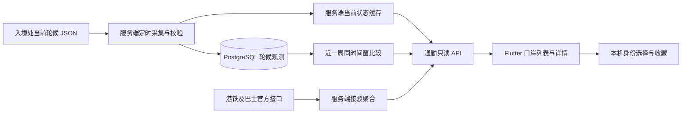

# 港深通勤功能设计与技术方案

> 状态：产品范围已确认，技术方案待实现。本文描述首版目标与拟议实现，不代表功能已经上线。

## 目录

- [1. 方案摘要](#1-方案摘要)
- [2. 背景、用户与范围](#2-背景用户与范围)
- [3. 页面与交互设计](#3-页面与交互设计)
- [4. 数据来源与语义契约](#4-数据来源与语义契约)
- [5. 采集、存储与近一周比较](#5-采集存储与近一周比较)
- [6. 接驳交通与接口设计](#6-接驳交通与接口设计)
- [7. 两端改造与实施顺序](#7-两端改造与实施顺序)
- [8. 风险、降级与待确认项](#8-风险降级与待确认项)
- [9. 验收要点与资料来源](#9-验收要点与资料来源)

## 1. 方案摘要

首版面向固定跨境、使用公共交通的通勤者，提供“口岸列表 → 口岸详情 → 香港侧主要接驳班次”的轻量决策入口。先覆盖**深圳 → 香港**方向的罗湖、福田和深圳湾口岸。核心指标是入境事务处对**港方入境手续轮候**的概括评估，而不是实时旅客人数或全程过关时长。用户可切换香港居民／访港旅客，查看与身份对应的官方等级和通常等候时间。

后端拟每 15 分钟独立采集两类官方状态；从采集启动时开始积累自己的观测历史，在详情中比较“现在”与**过去 7 个自然日同一 15 分钟时段**的等级。当前轮候与接驳功能无需等待历史积满一周即可上线。首版不做全程路径规划、平均等候分钟数、最佳口岸推荐、推送、Widget，也不接入每日客流统计作为拥挤度依据。

### 1.1 关键结论

| 维度 | 已定方案或现状 | 边界 |
| --- | --- | --- |
| 页面 | 三个口岸列表、单口岸详情、主要接驳班次；收藏口岸及已支持的路线 | 当前客户端仅有通勤入口文案，暂无通勤原生页面 |
| 轮候 | 使用入境处居民／旅客 JSON 的 `arrQueue`；官方标称每 15 分钟更新 | 只评估港方手续；状态码不是人数或精确分钟 |
| 历史 | 服务端独立定时保存观测，展示前 7 天同一时间窗的逐日比较 | 不导入官方历史包；采集启动前无自行积累的历史 |
| 接驳 | 罗湖／福田突出香港侧港铁，深圳湾突出主要巴士；明确线路、方向、上车位置及发车／到站时间 | 巴士站点与线路需逐一核实；不承诺赶得上某班车 |
| 实现 | `hkhub_server` 拟负责上游聚合、持久化与只读 API；`hkhub_app` 拟负责展示和本机偏好 | 后台定时采集、交通映射和 API 均尚未实现 |

### 1.2 端到端链路

图为**拟议架构**，不是现有组件清单；“当前状态缓存”可由最近一次有效采集记录及获取时间实现，不要求引入新的缓存服务。

## 2. 背景、用户与范围

原[产品需求与规划文档](产品需求与规划文档.md)提出实时过关指数、跨境交通联动与桌面 Widget。讨论后决定先做信息可信、可重复使用的口岸选择与接驳体验，而不是自造综合指数。

**已确认现状**：`hkhub_app/lib/app/router.dart` 尚无通勤路由，`modules/home/presentation/tool_grid.dart` 的 `nativeToolRoutes` 仅登记教育功能；服务端 `app/api/router.py` 未挂载通勤 API，首页工具的初始配置曾将通勤标为“待接入”。现有技术栈是 Flutter（`dio`、Riverpod、`go_router`、`shared_preferences`、`url_launcher`）与 FastAPI、`httpx`、PostgreSQL；后端以 SQL migration 管理表结构。设计优先复用这些能力。

**用户目标**：出门前快速看常用口岸的港方入境轮候；选定口岸后，快速找到香港侧可搭乘的主要巴士或港铁及最近班次；在有足够观测历史时，看今天同时间段的等级相对过去一周如何。

**首版范围**：深圳 → 香港；罗湖、福田、深圳湾；香港居民与访港旅客；港方入境轮候与经核对的香港侧接驳。仅有香港侧数据不能推断深圳侧排队或整程所需时间。

**非目标**：香港 → 深圳方向的完整产品体验；所有陆路口岸和所有接驳路线；个人出发地／目的地规划；班车可赶上性预测；自动推送、桌面 Widget；每日客流人数及基于人数的拥挤指数；完整的全程过关时间估计。后续扩大覆盖范围需重新核对每个口岸的物理接驳位置和官方数据。

## 3. 页面与交互设计

### 3.1 口岸列表

- 顶部提供“香港居民／访港旅客”切换，保存在本机；首次无选择时并列展示两类轮候情况，避免根据语言、位置或证件猜测身份。无需登录或录入证件。
- 每张卡片显示跨境成对名称、**港方入境轮候等级**及该人群对应的官方“通常”时间范围；选择身份前分别标注两类。口岸映射：**罗湖口岸 ↔ 罗湖管制站 `LWS`；福田口岸 ↔ 落马洲支线管制站 `LSC`；深圳湾口岸 ↔ 深圳湾管制站 `SBC`**。`LSC` 不得误映射到落马洲管制站 `LMC`。
- 收藏口岸置顶，其余使用稳定顺序；可由用户主动切换为按**有效轮候等级**排序。首次未选人群时不按等级排序，不混排两类不同时间阈值。不可把排序称为“最佳口岸”或“全程最快”。维护、非服务时段、缺失与过期状态不参与快慢排序。
- 卡片提供港铁／主要巴士接驳提示及数据状态；轮候获取时间与接驳数据时间独立显示。色彩仅辅助，文字须明确区分“正常／繁忙／非常繁忙／系统维护／非服务时段／暂无数据”。

### 3.2 口岸详情

1. **过关信息**：所选身份、港方入境等级、通常轮候时间、官方来源、最近成功获取时间；说明“不含深圳侧流程，不代表全程过关时长”。系统维护不写为口岸关闭；非服务时段不写为永久停运。
2. **香港侧主要接驳**：按真实上车站点、路线方向和目的地分组。港铁列车标明站台与**开出时间**；巴士标明实际香港侧上车站点及**到站 ETA／原定班次**，不能把开往口岸的车辆误标为出关后的接驳。支持收藏已支持的路线及通过外部地图查看**经核实**的上车位置；地图不可用时保留文字站点。
3. **近一周同时段参考**：当前等级与过去 7 个自然日逐日等级，显示有效样本数和“低于／相同／高于几天”。只有 7/7 天有效时才使用“近一周最低／并列最低”等完整周结论；否则仅描述实际有效天数。积累不足时显示“数据积累中”。
4. **操作**：前台自动刷新及手动刷新；轮候与交通独立失败、独立降级。关闭页面后无需继续高频刷新；刷新只请求本服务端，不触发客户端对官方接口的直连。

**展示示意（虚构样例，非实测）**：当访港旅客福田口岸 `arrQueue=0`，显示“正常 · 通常少于 30 分钟”，并标“港方入境轮候／访港旅客”；若当天为 `0`，前七天同时间窗中四天为 `1`、三天为 `0`，显示“比 4 天轮候等级低，与 3 天相同；处于并列最低等级”，不写“节省了 15 分钟”。

## 4. 数据来源与语义契约

### 4.1 入境处官方轮候

数据集：[陆路边境管制站等候时间](https://data.gov.hk/sc-data/dataset/hk-immd-set28-land-boundary-control-points-waiting-time)；官方说明为**每 15 分钟更新**、对港方出入境手续的轮候情况做**概括评估**。来源固定为[香港居民 `CPQueueTimeR.json`](https://secure1.info.gov.hk/immd/mobileapps/2bb9ae17/data/CPQueueTimeR.json)与[访港旅客 `CPQueueTimeV.json`](https://secure1.info.gov.hk/immd/mobileapps/2bb9ae17/data/CPQueueTimeV.json)。状态定义依据用户提供的[官方数据字典](https://www.immd.gov.hk/opendata/hks/transport/immigration_clearance/data_dictionary_for_land_boundary_control_points_waiting_time.pdf)：

| 码 | 等级 | 香港居民 | 访港旅客 |
| --- | --- | --- | --- |
| `0` | 正常 | 通常少于 15 分钟 | 通常少于 30 分钟 |
| `1` | 繁忙 | 通常少于 30 分钟 | 通常少于 45 分钟 |
| `2` | 非常繁忙 | 通常 30 分钟或以上 | 通常 45 分钟或以上 |
| `4` | 系统维护 | 不提供轮候等级 | 不提供轮候等级 |
| `99` | 非服务时段 | 不提供轮候等级 | 不提供轮候等级 |

JSON 以管制站代码为键，每站 `arrQueue` 为**入境香港**、`depQueue` 为**离境香港**；首版用户界面取 `arrQueue`，采集可保存两方向供审计，但不提供反方向产品承诺。不要把 `1` 写成一个有下限的区间；`2` 无上限；状态码不能做分钟加减或计算“平均排队分钟”。数据集的更新频率不等同于每次接口读取都对应一次新的官方评估。

**已观察到的边界**：所读取的当前 JSON 正文没有官方观测时间；在部分归档样本中 `LMC`、`HGP` 等键并非始终齐全。解析须按目标口岸逐项验证，不因一个无关口岸缺失使整个页面报错；目标口岸缺失、未知码、类型错误都作“暂无数据”，不得按 `0` 处理。详情中的时间要叫“最近获取时间”，而不是“官方最后评估时间”。

### 4.2 港铁与巴士

曾核实[港铁东铁线罗湖 `LOW` 的实时班次接口](https://rt.data.gov.hk/v1/transport/mtr/getSchedule.php?line=EAL&sta=LOW)、[落马洲 `LMC` 的实时班次接口](https://rt.data.gov.hk/v1/transport/mtr/getSchedule.php?line=EAL&sta=LMC)返回时间、目的地及站台。这里的港铁站码 `LMC` **与入境处的管制站码 `LMC` 不是同一个编码体系**：福田过关港方轮候用入境处 `LSC`，出关港铁用东铁线 `LMC`。巴士方面，[九巴公开接口](https://data.etabus.gov.hk/)可返回路线及 ETA，且班次可能标注“原定班次”。

**未确认前不入首批清单**：深圳湾等口岸对应的香港侧站点 ID、各路巴士的正确运营商、停靠方向、路线、运营时段、地图坐标，以及所需港铁／巴士接口的更新与使用约束。具体路线经实地／官方资料核实后列入静态支持清单，不通过关键词猜测“所有经口岸的线路”。空 ETA 不等于停运；香港侧站点与“去口岸”的站点不能互换。

## 5. 采集、存储与近一周比较

### 5.1 服务端自主采集（拟议）

采用独立于 App 访问量的后台调度：每约 15 分钟抓取居民及旅客两份当前 JSON，限定官方主机的固定 HTTPS URL，设置超时、有限重试与响应大小约束，校验数据结构和允许的码值。**状态不变也写入一次成功观测**；不导入手动下载的历史包，不通过用户请求触发抓取。抓取频率是采样计划，不保证官方刚刚发布过新版本。

现有 `app/main.py` 已持有供请求使用的 `httpx.AsyncClient`，但尚无定时采集任务；生产 `docker-compose.prod.yml` 只定义 API 容器。拟由**独立 worker／调度进程**运行采集与清理，复用后端配置及 PostgreSQL，不在每个 Web worker 的 lifespan 内启动无限定时器。若未来有多实例，需单实例调度或数据库互斥，确保一次时间窗内没有重复采样；幂等键可用 `(人群, 口岸, 方向, 香港本地日期, 15 分钟窗口)`。部署方式和恢复机制在实施阶段确认，不假定现有 cron 或队列服务已经存在。

每条成功观测建议保存 `port_code`、`audience`（resident／visitor）、`direction`（arrival／departure）、`status_code`、`fetched_at_utc`（请求完成时间）、`hk_date`、`hk_slot`（本地 00:00 起的 15 分钟窗口），以及来源标识。数据库统一保存 UTC 时间戳，比较时使用 `Asia/Hong_Kong`；对单口岸缺失或未知码记为无效，不伪造有效等级。整份请求失败时可另记采集失败／日志和监控，但**不得写 `0`、沿用旧数据生成新的“成功观测”**。定时清理只删除超过 30 天的观测记录；过期数据从比较中自然消失。精确的 SQL 表定义在实施时落实到后端 SQL migration。

**时间窗稳定性**：对一个香港本地 15 分钟窗口只取该窗口内一次有效采样；定时执行应落在窗口内并容许运行抖动。未在窗口内完成的请求不回填到前一窗口，不用其他时间的值顶替；若发生重复采样，持久化应去重并明确保留一次采样的时间。接口抓取成功不代表官方已更新，故只能说“在此时间采集到的官方状态”。

### 5.2 七天对比口径

给定当前香港时间 `now`，定义 `slot = floor((hour × 60 + minute) / 15)`，取**今天当前 slot 的当前有效状态**；若今日 slot 有有效落盘观测，优先以它为比较锚点，否则可展示最新实时状态，但**不以跨窗状态生成对比结论**。历史样本为前 1～7 个香港自然日的**同一 slot**，同一个管制站、同一人群、同为 `arrival`；当前和历史的可比状态只允许 `0/1/2`。

计算 `lower = count(today < history)`、`same = count(today == history)`、`higher = count(today > history)`；这里的大小仅表示官方轮候**等级顺序**，不是分钟差。记录 `valid_count = lower + same + higher` 并展示每一天具体结果：缺失／过期／维护 `4`／非服务 `99`／未知码单列原因，不参与计数。如果当前不是有效等级，不给出比较结论。`valid_count=7` 才可写“近一周最低／并列最低／最高”等完整周结论；不足 7 时只写“在有记录的 N 天中，比 X 天低，与 Y 天相同……”，同时标注 `N/7`，不称“本周低谷”。七天均为 `0` 时只写“均为正常等级”。**前 7 个自然日不是前 7 个工作日**，节假日可能不可比，需在文案中明确“近期同时间段参考”，不用于预测未来。

展示依赖一周的有效覆盖，历史积累中不阻塞实时页面。无需引入每日客流数据；客流量没有通道处理能力和小时分布，无法可靠换算成轮候。

## 6. 接驳交通与接口设计

### 6.1 接驳组织（拟议）

服务端维护经核对的“口岸 ↔ 香港侧上车地点／港铁站 ↔ 路线 ↔ 前往香港方向”映射。按不同上游数据源转换成统一班次语义：`scheduled_departure`、`estimated_arrival`、`scheduled_arrival` 等需显式区分；无法可靠判定的班次不包装成实时 ETA。每项带来源、实际车站／站台、目的地、资料获取时间及不可用原因。港铁站的离站班次不是“到站倒计时”；巴士抵达该站的 ETA 也不是抵达乘客目的地时间。外部地图入口只使用经过核实的地点或目标站点坐标，不拼未经审核的任意 URL。

具体首批巴士线路和站点 **尚未核实**，实施前必须形成经过上游 API 验证的支持清单；如某口岸当下没有可确认的班次，详情展示“接驳资料暂不可用／暂无班次”，而不使用别的口岸线路填充。

### 6.2 客户端使用的建议 API（新接口，非现有实现）

| 建议路由（现有 `api_prefix=/api`） | 用途 | 主要参数与返回信息 |
| --- | --- | --- |
| `GET /api/commute/borders` | 列表，居民和旅客状态并列返回 | 三口岸名称、港方 `arrival` 状态码、状态来源、最近获取时间、可用／过期标识 |
| `GET /api/commute/borders/{port_code}` | 单口岸轮候与元数据 | `port_code` 限 `LWS/LSC/SBC`；口岸配对、两类状态、接驳类型及信息说明 |
| `GET /api/commute/borders/{port_code}/history?audience=visitor` | 同时间窗七天比较 | 当前时间窗、逐日记录、有效数、低／同／高计数、是否可使用整周结论 |
| `GET /api/commute/borders/{port_code}/transit` | 港方出关后的主要接驳 | 已核对路线、方向、实际站点、班次类型及时间、各数据源的获取状态 |

响应中保留机器可读状态码，由 App 按已定义的人群和语言展示“通常”时间；也可返回稳定的状态枚举，但**不得只给无来源的“拥挤指数”**。列表／历史／交通独立可用，建议支持 `no-store` 或短时缓存并明确 `fetched_at`；外部源失败时返回局部不可用，避免把整个详情变为 500。参数和真实状态码、字段结构需要在接口实现时与客户端同步定稿；以上是**拟议契约**，不是已发布接口。

本机使用 `shared_preferences` 保存所选人群、收藏口岸和收藏路线；无需服务端用户表。收藏键建议隔离不同 API 环境，避免开发环境偏好混入生产显示。客户端继续使用现有 `ApiClient`、`go_router` 与多语言能力，新增通勤原生页面后才将 `commute` 加入 `nativeToolRoutes`，并同步首页工具配置；服务端不向客户端远程下发任意可执行的原生路由。文案覆盖项目已有语言 `zh-Hans`、`zh-Hant`、`yue-Hant-HK`、`en`。

## 7. 两端改造与实施顺序

1. **核验数据**：确认入境处三个目标站键值和居民／访客时间阈值；逐条核实港铁车站编码、运营方向、深圳湾及其他接驳巴士的香港侧车站 ID、运营商与地图位置。未核实路线不上线。
2. **服务端实时链路**：在 `hkhub_server` 增加通勤领域读取与正规化、当前数据采集、只读路由、独立数据源错误和获取时间；复用现有 `httpx`、FastAPI、SQL migration 约定，不将外部源 URL 作为客户端可控参数。
3. **服务端历史链路**：数据库 migration、新的单实例定时 worker／调度、15 分钟幂等写入、30 天清理、近七天同窗计算与采集失败监控。上线前确认生产环境 worker 部署及数据库迁移顺序，保证无人访问时仍在采集。
4. **Flutter 页面**：新增通勤列表／详情、双人群切换、本机收藏、刷新与多语言；先接当前轮候与核实过的班次，再逐步显示有效历史覆盖。页面和数据链路就绪后再打开首页原生入口。
5. **灰度与回退**：先验证外部接口连通、代码映射、数据新鲜度与后台采集，然后开放首页入口。若采集异常，可在客户端把历史区降级为“数据积累中／暂不可用”，当前轮候和接驳分别继续工作；回退首页入口不应删除已合法积累的历史记录。

以上为实施建议和依赖顺序，不表示已经创建迁移、worker、页面或已完成线上核验。

## 8. 风险、降级与待确认项

| 问题 | 处理原则 / 待确认工作 |
| --- | --- |
| 官方 JSON 无评估时间 | 展示**实际获取时间**；只能证明曾获取到该值，不能承诺刚发布。建议对超过一个以上预期更新周期的记录明确标为过期；具体过期阈值需结合真实上游行为确定，不因按时请求到相同内容就声称官方重新评估。 |
| `4`、`99` 与缺失 | `4` 是数据系统维护，`99` 是非服务时段；网络失败、键缺失与未知码分别标“暂无数据”，不可当作口岸关闭、正常或拥挤。 |
| 15 分钟采集抖动或部署重启 | 仅比较真正落入同一香港本地时间窗的有效记录；记录覆盖率、失败原因；确保不靠 App 打开触发采集。 |
| 交通 API 字段差异 | 区分港铁离站和巴士到站、实时与原定班次；站点与方向逐项核实。交通不可用不改变轮候等级。 |
| 相同等级内排队差异 | 官方等级粗粒度；两天同为正常，不说明分钟完全一样。历史比较只表达等级高低，不换算时间差、概率或行程节约。 |
| 生产调度方式 | 现有 Compose 只有 API 容器；实施前确认单独 worker 的部署、互斥、启动时迁移及故障恢复方式。 |
| 第三方数据许可与频率 | 接入前核对入境处、港铁、巴士公开接口的使用条款、请求频率和署名要求；不要声称已取得商业使用授权。 |
| 历史日范围 | 用户最终决定为**前七个自然日**而非前六天；仅自主采集，不承诺追溯上线前历史。 |

## 9. 验收要点与资料来源

**实现后的可观察验收项**：

- 列表只含首版三口岸，福田的入境轮候来自 `LSC.arrQueue`，罗湖来自 `LWS.arrQueue`，深圳湾来自 `SBC.arrQueue`；两类用户同码 `0` 分别展示“通常少于 15／30 分钟”。
- `1/2/4/99`、缺站键、未知码、网络错误有不同正确显示；显示“最近获取时间”，不声称为官方评估时间；外部交通失败不把轮候状态改为正常。
- 收藏口岸置顶，人群切换后偏好留在本机；首次未选人群时两类并列显示；详情的港铁离站、巴士到站与计划班次文案不混淆。
- 不打开 App，定时采集也会积累观测；相同状态的不同有效时间窗有各自记录；中断采集留下缺口而不产生假观测；存储只保留约定的 30 天范围。
- 同口岸、同人群、同方向、同香港本地 15 分钟窗只比较前 7 个自然日；`4/99`、缺失不进等级比较。完整七天才展示“近一周最低”等结论；历史不足明确显示有效天数或“数据积累中”。
- 口岸详情的接驳仅展示已核对的香港侧站点与方向；上游无数据时明确告知，不捏造班次或目的地到达时间。

**资料来源与已核查位置**：

- 原始产品范围：[产品需求与规划文档](产品需求与规划文档.md)，第 3 节“港深跨境通勤与口岸决策”；本文中的收敛决策来自本次产品讨论。
- 入境处[数据集页面](https://data.gov.hk/sc-data/dataset/hk-immd-set28-land-boundary-control-points-waiting-time)、[数据字典](https://www.immd.gov.hk/opendata/hks/transport/immigration_clearance/data_dictionary_for_land_boundary_control_points_waiting_time.pdf)、[居民当前 JSON](https://secure1.info.gov.hk/immd/mobileapps/2bb9ae17/data/CPQueueTimeR.json)、[访客当前 JSON](https://secure1.info.gov.hk/immd/mobileapps/2bb9ae17/data/CPQueueTimeV.json)。状态阈值来自用户贴出的字典内容。
- [港铁罗湖接口](https://rt.data.gov.hk/v1/transport/mtr/getSchedule.php?line=EAL&sta=LOW)、[港铁落马洲接口](https://rt.data.gov.hk/v1/transport/mtr/getSchedule.php?line=EAL&sta=LMC)、[九巴数据入口](https://data.etabus.gov.hk/)；具体巴士站点及地图对应关系尚待核实。
- 当前项目代码：`hkhub_app/lib/app/router.dart`、`hkhub_app/lib/modules/home/presentation/tool_grid.dart`、`hkhub_app/lib/app/network/api_client.dart`、`hkhub_server/app/api/router.py`、`hkhub_server/app/main.py`、`hkhub_server/docker-compose.prod.yml`。这些位置说明现状与接入点，不表示方案已实现。
