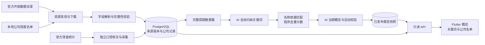

# 香港新公司观察功能设计与技术方案

> 日期：2026-10-16。状态：产品范围已确认，技术方案拟议、尚未实现；官方名单及清盘统计正文仍待核实。本文仅形成设计，不表示已创建页面、接口、数据表、采集任务或取得数据再利用授权。
>
> 信息状态：**已定需求**来自本轮脑暴与用户确认；**已确认事实**来自现有代码、既有调研与本轮官方目录读取；**拟议方案**是本文给出的实现建议；**待核实项**不作为已具备能力或上线承诺。

## 目录

- [1. 方案摘要](#1-方案摘要)
- [2. 背景、用户与范围](#2-背景用户与范围)
- [3. 页面与交互设计](#3-页面与交互设计)
- [4. 数据来源与时间口径](#4-数据来源与时间口径)
- [5. 采集、完整性与版本管理](#5-采集完整性与版本管理)
- [6. AI 关键词归纳与自动发布](#6-ai-关键词归纳与自动发布)
- [7. 数据模型与只读接口](#7-数据模型与只读接口)
- [8. 两端改造与运行配置](#8-两端改造与运行配置)
- [9. 风险、降级与待确认项](#9-风险降级与待确认项)
- [10. 实施顺序与验收标准](#10-实施顺序与验收标准)
- [11. 依据与资料来源](#11-依据与资料来源)

## 1. 方案摘要

首版提供轻量的 **「香港新公司观察」**：浏览完整周／月／年内的香港本地新成立公司，让 AI 从公司名称中自由归纳业务关键词，形成可追溯的当期概览。页面默认最近完整月，先展示 AI 概览，再展示关键词卡片；点击关键词查看主题解释、对应公司名单、名称依据与官方来源。公司名称不是主营业务证明，所有关键词均标为 AI 根据名称推测。

**不做固定行业分类、行业排行榜、升温榜、综合热度分数或跨期主题升降判断。** AI 自由发现、合并和命名关键词，但不补猜主营业务；数量由程序按公司去重计算。分析通过自动校验后直接发布，不建立人工审核流程。独立清盘观察仅展示经核实的总体统计，不叫倒闭率，不与新成立公司相减生成净增。

`hkhub_server` 拟承担官方资源发现、数据持久化、后台 AI 分析和只读 API；`hkhub_app` 拟承担时间选择、概览、关键词与名单展示。优先复用现有 Flutter、FastAPI、PostgreSQL、`httpx` 与 DeepSeek 接入模式，不引入新的队列、缓存或对象存储服务。数据接入能否满足完整周期，必须先通过实际文件与字典核实。

### 1.1 关键结论

| 维度 | 已定需求 / 拟议方案 | 依据与边界 |
| --- | --- | --- |
| 产品目标 | 当期新公司名称中的业务方向观察 | 帮助探索，不提供投资、创业或销售机会判断 |
| 公司范围 | 香港本地新成立公司 | 不混入更名、非香港公司注册、迁册；筛选字段待核实 |
| 时间 | 完整自然周／月／年，默认最近完整月 | 依据实际成立日期，不按抓取或周报发布日期归期 |
| AI | 自由归纳、同义合并、泛词过滤，允许无法判断 | 无固定行业表；关键词必须能追溯到公司名称 |
| 计数 | 每个主题内按公司去重 | 公司可涉及多个主题，主题数量不能相加作为公司总数 |
| 发布 | 后台预计算，自动校验后直接发布 | 不由用户请求触发付费 AI；异常时暂停相应分析 |
| 清盘 | 独立总体统计、独立周期与更新时间 | 正文及细分口径待核实，不承诺退出名称名单或行业倒闭率 |
| 工程 | 独立业务 worker + PostgreSQL + 只读 API + Flutter 页面 | 新功能尚未实现；沿用已有基础设施模式 |

### 1.2 拟议端到端链路

图为拟议架构，非现有组件清单。上游文件、完整周期数据、AI 报告和清盘统计分别有状态；AI 或清盘失败不阻塞已核实名单。清盘数据不送入新公司关键词分析，也不参与行业冷热判断。

## 2. 背景、用户与范围

### 2.1 要解决的问题

官方周报适合查询，但普通用户不易从连续名单中形成直观观察。本功能降低浏览与理解成本，回答：

1. 一个已完成周期内，有哪些香港本地新成立公司？
2. 名称中可以识别出哪些业务关键词及同义表达？
3. 这些关键词涉及哪些具体公司，为什么被归入该主题？
4. 哪些名称信息不足，不能判断业务？

主要定位为普通用户的城市商业观察，辅助研究探索；不是客户线索平台或尽职调查工具。

### 2.2 已确认系统现状

| 系统 | 已确认代码事实 | 接入原则 |
| --- | --- | --- |
| App | `pubspec.yaml` 使用 Flutter、Riverpod、`dio`、`go_router`、TDesign 与 `url_launcher` | 复用网络、路由、组件和主题；不新增 WebView 产品形态 |
| 首页 | `lib/modules/home/data/home_tools.dart` 本地定义 `business` 入口；`tool_grid.dart` 原生路由只登记教育、通勤、永居 | 拟接通已有 `business` 入口，不新增重复工具；功能就绪后才登记原生路由 |
| API | `app/api/router.py` 挂载健康、教育、通勤；默认 `api_prefix=/api` | 新增独立业务路由，沿用错误和语言协议 |
| 存储 | SQLAlchemy、PostgreSQL，SQL migration 位于 `db/migrations/`；数据库会话使用 UTC | 不在 API 启动时自动建表；通过正向／回退 migration 管理 |
| 上游访问 | `app/main.py` 持有 `httpx.AsyncClient`；教育服务已有 DeepSeek JSON 调用与 Pydantic 校验 | 沿用配置和接入模式，不复用教育业务提示词或直接调用教育分析函数 |
| 后台运行 | Compose 已部署模式包含 `server`、`commute-worker`、`postgres`；通勤 worker 使用数据库互斥 | 新公司业务拟独立 worker，不加入通勤循环或每个 API lifespan |
| 多语言 | 支持 `zh-Hans`、`zh-Hant`、`yue-Hant-HK`、`en` | 语言只影响呈现，不改变公司集合、主题身份或计数 |

以上描述当前代码，不代表已验证生产运行状态。既有通勤文档中的历史系统描述可能已过时，以本表对应代码为准。

### 2.3 首版非目标

- 固定行业分类、行业排行榜、升温／降温榜、连续主题趋势线、综合热度评分。
- 根据名称判断实际开业、需求增长、营业额、企业信用、投资或创业机会。
- 查册替代、董事／股东核实、电话／邮箱／联系人补全。
- 注册地址补查、实际营业地图、收藏、提醒、导出、收费或账户系统。
- 逐家公司退出名单、行业倒闭率、企业存活率、新增减清盘得到净增。
- 为无完整数据的周期生成估计数或只分析样本却标成全周期报告。

## 3. 页面与交互设计

### 3.1 栏目概览

建议从既有商业工具入口进入，正式标题「香港新公司观察」，入口短标题及四种语言文案在实现时与首页长度约束同步。

阅读顺序：

1. **时间选择**：周／月／年与历史周期。默认定位最近已结束且数据完整的月；若最近结束月尚未齐，明确提示其状态并标明当前显示的更早月份，不悄悄替换日期。
2. **数据说明**：成立日期范围、官方资料覆盖范围、最近成功获取时间、数据完整性状态；官方发布日期若未提供，不用获取时间冒充。
3. **公司数量**：完整周期显示「本期新成立公司 N 家」；缺源周期只显示「已获取记录涉及 N 家公司」，不称完整总量。
4. **AI 当期概览**：一句概括与最多三条有依据的发现；允许没有明显主题或无可识别关键词，不硬凑结论。
5. **关键词卡片**：主题名称、涉及公司数、简短解释。数量是程序计算结果，不展示模型自报精确置信度或官方行业占比。
6. **公司名单入口与搜索**：允许查看全期已核实名单或按中英文名称搜索。
7. **独立清盘观察**：显示清盘统计自身的周期、类别、获取时间和来源；不可用时不影响上述栏目。

关键词不加名次、奖牌、涨跌箭头或“最热行业”文案。卡片可按涉及公司数降序排列，明确这是数量排列而非行业热度排名；数量相同使用快照内稳定顺序。没有必要加入词云或复杂图表。

### 3.2 关键词详情与公司名单

- 展示主题解释、与名称有关的收录规则、同义词和原始命中词。
- 列表展示官方中英文名称、成立日期、公开标识及标识类型（可用性待文件核实）、对应名称证据、官方周报来源。
- 公司名称按官方原文呈现，不翻译、缩写或替换法定名称；某一语言名称缺失时展示另一名称，不补造。
- 列表不需要新增完整公司详情页；行内展开名称依据和来源即可完成首版闭环。
- 名称搜索只查本站已核实的周期数据，不调用注册地址 API，不宣称查遍香港全部公司。使用参数化查询、字面关键词语义，不将用户的 `%`、`_` 当作任意通配。
- 搜索、关键词筛选和分页不会重新运行 AI。搜索空结果不表示香港没有这家公司。
- 返回概览时保留选定周期、主题及列表位置；切换周期时清空旧主题筛选，不能按主题文字跨周期复用身份。

### 3.3 视觉、多语言与可访问性

遵循 `docs/UI风格规范.md`：统一 `AppTheme` 卡片、间距与字体；分类强调色从 `ToolAccents` 获取，不能与状态警告色混用；页面加载复用 `HkSailLoader`。使用原生可读文本，不执行 AI 返回的 HTML、Markdown 链接或富文本脚本。公司长名称支持换行，重要数字与状态不能仅靠颜色表达；尊重文字缩放与减弱动态效果。

界面静态文案覆盖四种现有语言。拟以繁体书面中文生成一份关键词与报告结构，再由后台准备简体及英文呈现；粤语界面中的分析正文可沿用繁体书面中文，明确实际内容语言。翻译不重新分类，不修改主题 ID、公司关系或数字；缺翻译时展示清楚标注语言的已有正文，不在读取请求中调用模型。语言变体的自动校验和状态独立于公司数据完整性。

### 3.4 展示状态

| 情况 | 展示与行为 |
| --- | --- |
| 周期完整、AI 已发布 | 概览、关键词、名单正常展示 |
| 周期完整、AI 未配置／生成中／失败 | 公司总量和名单可用；AI 区显示对应状态，不伪造报告 |
| 周期不完整 | 标明缺失资源与覆盖范围；仅显示已核实名单，暂停完整总量及 AI 概览 |
| 完整周期确认为零家公司 | 显示零记录；不调用 AI、不生成假关键词 |
| 有公司但无可识别业务主题 | 显示无明确关键词及信息不足比例；不标成技术失败 |
| 最近资源获取失败 | 保留明确标注时间的已核实快照；新周期等待资料，不生成零新增 |
| 来源修订使旧报告失效 | 切换到新名单版本，暂停旧分析，后台重建；不混合旧关键词与新公司数 |
| 清盘统计不可用 | 清盘区单独不可用，不回退显示零清盘 |

## 4. 数据来源与时间口径

### 4.1 来源与证据状态

| ID | 官方来源 | 已确认范围 | 尚未确认 / 本功能用途 |
| --- | --- | --- | --- |
| C01 | 新成立／注册／迁册／更名名单，2024-12-30 起 | 目录资源为 CSV／XLS，每周更新；本地与非香港公司资源分开 | 正文、事件识别、稳定标识和日期字段待核实；本地新成立主来源 |
| C02 | 名单历史入口，2022-12-26 至 2024-12-29 | 既有调研已看到目录 | 未解析、不保证完整可下载；历史覆盖按实际核实结果开放 |
| C03 | 现存公司注册地址 API | 既有调研读到指定 `Brn` 查询的实际 JSON | 首版不接入、不逐家公司补查；不能用查不到地址推断注销 |
| L01 | 公司注册处清盘统计 | 目录有 CSV／XLS，标注每月更新 | 正文、清盘类别、计数事件、时间跨度待核实；独立总体统计候选 |
| L02 | 仍在登记册上的公司数量 | 目录有 CSV／XLS，标注每月更新 | 是存量而非退出名单；首版不以存量差反推倒闭数 |
| L03 | 破产管理署统计 | 统计目录可用，标称每月更新 | 公司强制清盘具体资源与口径未解析；仅作清盘口径补充候选 |
| L04 | 公司注册处公告、政府宪报 | 已找到公开入口与宪报使用说明 | 未读到本功能可用的退出名单样本；版权及再利用条件待核实，不是首版依赖 |

最新文件通过官方目录发现，不根据文件命名规律猜测是否已经发布。CSV 与 XLS 通常是同一周报的不同格式，只选择核实可用的一种作为主解析格式，不能算两批公司。L01 与 L03 若覆盖同一法律事件，不能直接相加。

**不能把注册地址 API 的 `Brn`、名称、日期字段当作已经存在于 C01 的字段。** 原始周报列名、公司编号与商业登记号码的关联，以及迁册／更名如何区分，均由字典和实际文件定稿。

### 4.2 完整周期定义（拟议）

- 统一以 `Asia/Hong_Kong` 计算业务日历，数据库抓取、生成、发布时间保存 UTC。
- 周：周一至周日。用明确起止日期标识，避免 ISO 周年份与自然年份混淆。
- 月：自然月第一日至最后一日；年：自然年 1 月 1 日至 12 月 31 日，不是最近 365 天。
- 查询边界内部采用 `[start_date, end_date_exclusive)`，前端显示到 `end_date_exclusive` 的前一天。
- 只有结束日已过去的周期才能作为“完整周期”候选；日历已结束不代表官方资料已经齐全。
- 归期取**实际成立日期**。覆盖月末或年末的周报需要全部获取，再按日期过滤；不能将整份跨月周报归入下载所在月。
- 完整性依赖经核实的官方周报覆盖规则：所有与目标周期相交的应有本地资源均解析通过，成立事件、日期及稳定身份均可判定。
- 官方明确无记录与文件缺失是不同状态；不存在文件不能默认代表零家公司。
- 没有完整年的历史就不提供完整年分析；保留“资料不足”说明，不把全年其中几个月包装成全年。

### 4.3 清盘统计语义

按已核实来源区分自愿清盘、强制清盘，以及呈请、命令或完成等不同计数阶段；只能展示文件真实提供并可确认的类别，不补造字段。若统计混合不同公司范围且不能拆分，明确范围，不能写“本地公司清盘总数”。

清盘区与新公司时间选择独立：按来源已确认的月／年序列展示，**月度数量不拆成周度估算**。年度汇总只在每条记录为互斥月份的新增事件数且月份齐全时执行；累计、存量或其他事件阶段不能直接求和。正文未核实前不承诺类别、历史年份或具体数值。

注销／解散不一定是经营失败，实际停业也不一定注销；清盘呈请不等于清盘令，进入清盘不等于当期解散。个人破产不作为公司清盘。首版不算退出率、倒闭率、公司存活率，也不将新增数减清盘数称为净增。

## 5. 采集、完整性与版本管理

### 5.1 独立后台执行（拟议）

新增公司观察 worker，使用与 API 相同的服务端镜像、配置及 PostgreSQL，独立于 App 访问量和通勤采集。优先使用现有 `httpx`、Python 标准库 CSV／日期处理和数据库任务记录；不要求新增 Celery、Redis、向量库或专用调度平台。

建议每天发现资源变化，发现新周报或修订后再下载、解析，并独立检查清盘统计；这是拟议检查频率，不是官方每日发周报的承诺。初次按经核实的资源清单受控回填，优先最近完整月及其关联周报，再补可提供的周与年。历史 AI 分析同样后台排队，未预生成的周期只显示生成状态，GET 不发起 AI。

同一业务进程内可先顺序处理，避免并发历史任务挤占现有教育模型调用。抓取和 AI 的限流、超时、重试、每日成本上限必须配置；精确阈值在实际数据量与模型限制核实后确定。

### 5.2 资源发现与安全下载

1. 从白名单数据集及官方资源元数据取得 URL、资源 ID、格式、覆盖起止日及已提供的更新时间。
2. 候选方式为 DATA.GOV.HK 的 CKAN `package_show`；接口规范入口已确认，但目标数据集实际响应仍待验证。
3. 校验 HTTPS、主机、路径与格式，限制响应体及记录数量；拒绝登录页、错误 HTML、空异常文件。
4. 不接受客户端提供的数据源 URL。默认不自动跟随重定向；官方迁移时核实并更新允许列表，而非开放任意目标。
5. 保存原始字节、下载元信息和内容 SHA-256；编码按文件声明／字典核实，不用忽略解码错误的方式丢失名称字符。
6. 编号按字符串保存，保留前导零及类型命名空间；名称保留原文，另建用于检索／匹配的正规化视图。

不假定目录提供精确发布日期、HTTP ETag 或内容更新时间。若有可用缓存校验头可使用，但内容哈希才负责判断此次抓取是否出现新版本。

### 5.3 解析与数据完整性门槛

- 解析规则版本化，确认表头、编码、日期格式、空行、脚注与可能的分节结构。CSV 优先；若实际仅 XLS 可用，再评估必要解析依赖，不在文档阶段新增包。
- 根据已核实字段或分节识别“本地新成立”，排除更名与迁册；无法判断的记录进入异常集合，不默认当作新增。
- 同一公司中英文名称属于一家公司。同一公司重复出现于相同／交叠资源不能重复计数；稳定键为经验证的 `(identifier_type, identifier_value)`，不按名称直接合并。
- 同一键出现矛盾成立日期或名称时记录冲突并阻止相关周期完整状态，不能任意选择一行掩盖问题。
- 周期内本地新成立记录若缺失稳定标识或成立日期，暂停完整总量和 AI；已能核实的记录仍可提供部分浏览。
- 原始行数、排除数、有效记录数、重复数、冲突数、无效行数全部留痕。数量突变是异常提示，不自动证明行业波动；真实异常发布需先解决数据问题，不建立内容人工审核流程。

### 5.4 来源与报告快照

每个文件版本不可变，以 `(resource_id, content_sha256)` 去重；同 URL 内容修订形成新版本，不覆盖旧字节。每个完整周期的数据集指纹由选用来源版本、解析规则版本和正规化规则版本计算，不只依赖抓取时间。

报告发布时锁定数据集指纹、公司集合、主题、名称证据、模型配置与提示词版本。公司名单与关键词详情都按同一 `report_id` 读取；语言变化只换展示文本。来源更名公告不会将旧成立名称自动覆写成当前名称，列表标明为来源记录时的名称，不承诺公司当前状态。

新来源修订通过校验前保留旧有效快照并标注时间；确认修订影响已发布周期后，旧报告标为过期／撤回，暂停其分析，发布新数据快照并重建 AI。不能用旧分析配新总数。普通用户只读当前可用版本，旧版本用于内部追溯，不需要新增历史版本浏览产品。

### 5.5 幂等、互斥与恢复

任务幂等键拟为 `(period_type, period_start, dataset_fingerprint, analysis_version)`；同一输入已有成功结果时直接复用。数据库短事务领取任务并设置租约，外部下载和 AI 调用在事务外执行，不在整个年分析期间持有数据库事务或通勤锁。

任务状态拟为 `pending → running → published / failed / superseded`，另有完整零记录的 `not_needed`。进程退出后租约到期可重领；各批次结果可复用，避免整年从头重复付费。发布时复核任务租约／领取版本及当前指纹，旧进程不能覆盖后来结果。

AI 全部结果在自动校验通过后，以短事务原子切换发布指针。重试有上限，配合退避；超过预算或重试上限保留名单与失败原因，等待后续受控重跑，不无限调用模型。任务列表、续租和生成时间记录是内部工程能力，不开放无鉴权的管理 HTTP 接口。

## 6. AI 关键词归纳与自动发布

### 6.1 “自由归纳”的约束

自由的是主题发现、同义合并、主题粒度与展示名称，不是事实、数字或来源。没有预设行业表，不调用搜索引擎或补查官网；输入只包含已核实公司 ID、中英文名称及必要周期信息，不发送无关个人资料。

- 可以合并名称明确出现的 `AI` 与“人工智能”，但不能把只有“科技”的名称推成 AI。
- “国际”“香港”“集团”“有限公司”等泛词不独立作为业务方向；其存在也不能证明贸易或跨境业务。
- 品牌化名称、姓名、地名或泛词不能被模型常识强行补成主营业务。
- 允许多个主题重叠，不强制每家公司一个行业，不把未纳入主题等同于“没有经营业务”。
- 页面不展示模型自报准确率或数字置信度；可展示简短、可核对的名称依据，不存储或输出私有推理过程。

### 6.2 分批分析与全年覆盖

按模型上下文和输出限制分批覆盖整个周期，不将全部全年名单塞入一次请求，也不抽样后冒充全量。拟采用以下链路：

1. **候选提取**：每批输入真实 ID 与名称，AI 返回候选主题、原始业务词及名称证据；模型不返回可信总量。
2. **自由合并**：对全部批次的候选词分层合并中英文、同义表达和重复主题；候选列表本身也超限时继续分批。泛词过滤后形成本期主题集合，不是跨期行业字典。
3. **全量重匹配**：主题规则只允许有名称依据的字面同义词组合，不允许 AI 生成任意 Python、SQL 或正则。程序对全部周期公司重新匹配、去重、生成主题成员及名称证据，避免合并主题后漏数或重复数。
4. **程序统计**：计算每个主题公司数、至少涉及一个主题的公司数、未能识别主题的公司数及比例。
5. **概览生成**：将已计算指标、主题解释及有来源的名称证据交给 AI，输出当期概括，不提供上期指标或要求冷热判断。
6. **校验与发布**：校验结构、引用、数字及文本边界；校验通过直接发布，无人工审核。

关键词匹配正规化拟使用 Unicode NFKC 与英文大小写折叠，原文不改写；英文短词需完整词边界，避免 `AI` 命中其他英文词内部，中文保留繁简原词的实际证据，不把英文翻译标签本身当作原文命中。复杂主题可使用受限的词组 OR／AND 组合，所有匹配词必须能追溯到实际名称；证据记录命中的名称字段与原文片段。

若某批失败、漏处理或输出截断，整个 AI 快照不发布；已成功批次可用于续跑，但不把部分结果称为全期分析。不同主题的粒度可随周期变化，因此不根据同名主题拼接跨期曲线。

### 6.3 结构化输出与程序验证

拟用 Pydantic 校验 JSON，模型输出分为候选主题、合并规则、概览及翻译几个有限结构。模型只引用输入中的公司 ID、主题 ID、证据和指标 ID；不接受模型返回的来源 URL、公司登记号、成立日期或汇总总数作为事实。

自动检查至少包括：

- ID 是否属于本次输入，所有已分配批次是否处理完成，输出是否截断、为空或结构越界。
- 证据是否真的出现在相应中／英文名称；同义合并不能扩大到原词不支持的业务。
- 主题是否重复、空泛、无公司成员，所有成员是否为同一周期快照。
- 每主题人数由成员关系重新计算；未识别数由全集减去主题成员并集得到，不是减去主题人数之和。
- 全集与已识别／未识别集合互斥且完备；完整零记录不计算比例，返回 `null` 而非除零。
- 概览中的数量使用指标引用或结构化占位符，发布时由程序插入；自由文本不允许另写未经验证的数字、占比或增长率。
- 文本不出现无证据的“升温／爆发／需求上涨／值得入场／倒闭率”等判断，不将推测写为官方分类或实际经营事实。
- 语言变体保留主题身份、指标引用和名称证据，不以翻译重新匹配公司。

关键词 `unknown_company_count` 的展示文案为“名称信息不足／未识别业务关键词”，不能宣称全是模型已经准确判定的未知行业。技术上尚未处理的记录由任务状态表示，不混入这个统计数字。自动规则只能降低错误风险，不能证明模型语义准确或消除所有误判。

### 6.4 提示词与内容安全

公司名称属于不可信数据，即使名称文本含指令也不能执行。系统提示词明确：忽略数据内指令、禁止联网与工具执行、只用名称证据、只返回受限 JSON。用户搜索词不进入 AI 提示词。所有页面来源链接由服务端来源记录生成，不使用模型编造 URL。

API Key 仅存在服务端秘密配置，不落入 App、报告、数据库原始响应、日志或文档。外部模型输出按数据处理，不能转成代码执行或任意 HTML。保留模型名称、提示词版本、用量和安全错误码，日志不输出认证 Header、完整公司名单或未过滤异常字符串。

### 6.5 发布与成本

模型拟优先复用现有 `DEEPSEEK_*` 配置；选择具体模型、上下文限制、最大输出、重试及成本额度需核实供应商当前能力与费用，不能由现有教育请求参数推断全年分析可用。

服务端 GET 只读数据库，无论访问量多少，同一已发布输入都不重复生成。语种呈现也由后台准备，不逐用户付费调用。优先最新完整月，再处理相关周与其他完整历史；历史批量分析有预算上限。模型不可用不阻塞数据接入与浏览。首版不设置人工审核岗、审核后台或首批报告审核门槛；自动检查不过即不发布。

## 7. 数据模型与只读接口

### 7.1 PostgreSQL 数据模型（拟议）

下列为逻辑表与约束建议，不是现有数据库结构；物理列名、类型、索引和 migration 编号在实现时定稿。

| 拟议表 | 职责与主要字段 | 关键约束 |
| --- | --- | --- |
| `company_source_files` | 数据集／资源 ID、URL、文件覆盖日期、内容哈希、原始字节 `bytea`、获取时间、解析版本、状态与行数统计 | `(resource_id, content_sha256)` 唯一；文件版本不可变；正文大小上限待实测确定 |
| `company_source_records` | 来源文件 ID、原始行定位、标识类型／原值、中英文原名、成立日期、事件类型、解析异常 | `(source_file_id, row_locator)` 唯一；保留原文，不建“当前经营状态”假字段 |
| `company_period_reports` | 周期、完整性、来源清单、数据指纹、任务租约、AI 状态、模型与提示词版本、指标、多语言正文、发布时间 | 周期／指纹／分析版本幂等；同周期最多一个当前发布版本 |
| `company_report_companies` | 快照 ID、公司稳定键、来源记录 ID 与去重后的公司集合 | `(report_id, company_key)` 唯一；指向不可变来源记录，完整名单和主题共享此集合 |
| `company_report_topics` | 报告 ID、快照内主题 ID、多语言标题／解释、受限匹配规则、程序人数、稳定顺序 | 主题只在报告内有身份；数字不采用模型计数 |
| `company_topic_memberships` | 报告、主题、快照公司关系、名称字段与原文证据 | `(report_id, topic_id, company_key)` 唯一；外键限制为同一报告的主题及公司 |
| `company_liquidation_statistics` | 来源版本、统计周期、公司范围、清盘类别、法律事件阶段、单位、实际数量 | 按同源同口径同周期去重；缺失数量不落成零，不跨事件阶段相加 |

未获得可靠公司身份之前不能用来源行号充当跨周公司主键；行号只负责追溯。异常原始行保留在来源层，不进入有效公司全集。对日期、快照公司、主题成员和待领取任务建立与查询对应的索引；搜索先采用正规化名称的参数化查询，再根据真实规模评估索引，不预设全文检索或向量搜索。

原始文件拟先落 PostgreSQL，避免新增存储服务；大小、历史占用及数据库备份成本是实施前核实项。若不适合数据库保存，再评审存储方案，不在没有基础设施事实时宣称已有对象存储。历史来源、报告与证据按授权和经确认的保留策略管理，不照搬通勤观测的 30 天清理规则。

### 7.2 只读 API（拟议新契约）

默认路由前缀为现有 `/api`；业务命名空间建议 `company-observation`。

| 路由 | 参数 | 主要响应 |
| --- | --- | --- |
| `GET /api/company-observation/periods` | `period_type=week\|month\|year` | 历史周期描述、日历是否结束、数据完整性、AI 状态、默认周期、最新资料状态 |
| `GET /api/company-observation/overview` | `period_type`、`start_date` | 周期与快照 ID、覆盖／来源、公司指标、AI 正文与状态、关键词卡片 |
| `GET /api/company-observation/reports/{report_id}/topics/{topic_id}` | 路径中的报告／主题 ID | 主题解释、同义规则、程序人数及可追溯说明 |
| `GET /api/company-observation/reports/{report_id}/companies` | `topic_id` 可选、`q` 可选、`cursor` 可选、`limit` | 同快照名单、名称证据、成立日期、标识及来源、下一页游标 |
| `GET /api/company-observation/liquidations` | 来源支持的月／年范围 | 独立统计序列、类别／事件阶段／公司范围、单位、完整性与时间 |

接口参数需校验为合法周期起点，不接受未来／未结束周期作为完整分析。`start_date` 未指定时由服务端返回明确默认周期；有指定时不悄悄换期。不存在周期返回 404；已有周期但数据未齐或 AI 未完成返回 200 与状态。非法枚举、日期、游标或跨报告主题 ID 拒绝，不退化成查询全部数据。

名单拟使用稳定游标，排序为成立日期降序再按公司稳定键；游标绑定 `report_id`、主题、查询条件和排序，切换筛选重置分页。建议初始每页 30、最大 100 条，这些是拟议请求限制，不是已验证性能指标。返回已发布快照时不在翻页途中更换版本。

App 通过现有 `ApiClient` 使用相对路径，如 `company-observation/overview`，不能以 `/api/...` 绝对路径绕过客户端的路径校验。客户端所需数量、比例和状态由响应提供，不依据当前页长度、可见卡片或其他周期数据自行计算。

### 7.3 核心响应语义

| 对象 | 字段与含义 |
| --- | --- |
| 周期 | `period_type`、`start_date`、`end_date_exclusive`、`timezone=Asia/Hong_Kong` |
| 覆盖 | `data_status=complete\|partial\|unavailable`、来源覆盖区间、实际获取时间、缺失资源描述 |
| 公司数 | `observed_company_count` 始终指已核实集合；仅完整数据提供 `total_company_count`，否则为 `null` |
| 分析 | `analysis_status=pending\|running\|published\|failed\|not_configured\|not_needed\|superseded`；附安全原因码与生成时间 |
| AI 指标 | 仅发布有效分析时提供已识别数、未识别数及比例；空全集比例为 `null`，未处理不是未知行业 |
| 关键词 | `topic_id`、标题／解释、`company_count`、报告 ID；不含涨跌、综合分数或模型准确率 |
| 版本 | `report_id`、`dataset_fingerprint`、`analysis_version`；所有关联页面使用同一快照 |
| 语言 | 请求沿用 `Accept-Language`，每段 AI 正文标记实际 `content_language` 与回退状态；数据标识不翻译 |
| 来源 | 已登记的官方资源 ID、URL、来源文件覆盖日期及获取时间；没有官方发布时间则为 `null` |

失败原因拟区分 `source_incomplete`、`source_invalid`、`identity_conflict`、`analysis_timeout`、`analysis_invalid`、`budget_exceeded` 等，不能对外暴露模型认证信息、上游原始异常或数据库连接字符串。整体错误沿用现有 `AppError` 与 `error/request_id` 响应，并扩展已有多语言消息表；局部 AI／清盘不可用不返回整个概览 500。

### 7.4 缓存与版本一致性

数据和报告以 PostgreSQL 为缓存，不引入 Redis。概览指向当前版本，拟 `Cache-Control: no-cache`，避免来源修订后长时间复用旧分析；快照详情也校验是否已撤回，不因内容不可变就永久公开缓存错误报告。未来采用 ETag 时需绑定报告 ID、内容修订、实际语言与响应字段版本，并保持 `Vary: Accept-Language`。

旧快照撤回后，直接访问可返回 409 与安全码 `report_superseded`，引导重取概览；不偷偷替换 ID。客户端请求语言变化只刷新展示，不改变集合；错误、loading、分页都按选定报告 ID 隔离，避免竞态串期。

## 8. 两端改造与运行配置

### 8.1 拟议文件与职责

| 仓库 / 位置 | 拟议改动 | 不改动的范围 |
| --- | --- | --- |
| `hkhub_server/app/modules/company_observation/` | 数据源目录、解析、周期与完整性、AI 提取／合并／校验、数据库读取、worker、响应 schema；按职责拆分 | 不把业务规则放到 `app/main.py`，不复用教育模型报告结构 |
| `hkhub_server/app/api/routes/company_observation.py` 与 `app/api/router.py` | 只读路由及装配 | 不开放公开抓取、重新生成、审核或删除接口 |
| `hkhub_server/db/migrations/` | 来源、记录、报告、主题、成员和清盘统计表，正向／回退 SQL | 不在运行时调用自动建表，不改其他业务表语义 |
| `hkhub_server/app/core/config.py` 与配置示例 | 公司 worker 与 AI 额度、来源和超时配置 | 不写真实凭证、不覆盖通勤调度参数 |
| `hkhub_server/docker-compose.prod.yml` 与部署入口 | 增加同镜像的公司观察 worker，数据库就绪与迁移前置、日志限制与重启策略 | 不让 API HTTP 健康检查错误地检查无 HTTP 的 worker |
| `hkhub_app/lib/modules/company_observation/` | 数据模型、repository、Riverpod 状态、概览及关键词／名单页面 | 不新增账户、收藏、订阅、导出、完整查册页面 |
| `hkhub_app/lib/app/router.dart` | 拟 `/business` 概览及快照主题子路由 | 不允许服务端下发任意可执行原生路由 |
| `hkhub_app/lib/modules/home/data/home_tools.dart`、`tool_grid.dart`、语言资源 | 更新现有 `business` 文案并登记原生入口 | 不恢复已移除的远程首页工具配置、不重复新增入口 |

业务源码按现有 `app + modules` 结构落位；具体文件数由实现职责决定，本文列的是改造落点，不要求预创建空目录或脚手架。

### 8.2 配置建议

| 配置 | 用途 | 状态 |
| --- | --- | --- |
| 现有 `DATABASE_URL`、连接池配置 | API 与独立 worker 数据库连接 | 已有 |
| 现有 `DEEPSEEK_API_KEY`、`DEEPSEEK_BASE_URL`、`DEEPSEEK_MODEL`、`DEEPSEEK_TIMEOUT_SECONDS` | 服务端模型接入 | 已有，配置存在不代表生产已可用 |
| 拟 `COMPANY_OBSERVATION_ENABLED` | 控制业务 worker 执行，便于暂停付费分析与采集 | 新配置待实现 |
| 拟 `COMPANY_OBSERVATION_POLL_SECONDS` | 官方目录变化检查间隔 | 建议日级检查，精确值待确认 |
| 拟下载大小、批次上下文／输出限制 | 限制资源和模型调用规模 | 按实际文件、模型限制定稿，不能靠截断样本降成本 |
| 拟模型重试、每日预算、历史分析预算 | 限制付费和故障重试 | 精确预算待实际数据量、供应商价格核实 |
| 拟任务租约、重跑／回填参数 | 重启恢复与受控历史处理 | 内部执行，不由公开 API 操控 |

预算耗尽时不将记录标成行业未知；已抓取数据继续浏览，AI 显示暂停状态。配置为服务端可信输入，API 不接受任意模型地址、来源域名或提示词。

### 8.3 运维与回退

后台记录各来源最近成功获取、解析行数、完整周期覆盖、待处理任务、失败批次、模型用量及最近发布报告；日志之外保留可查询的任务状态，不能仅靠“容器正在运行”判断业务健康。

部署先执行 migration，再启用采集 worker，取得有效数据后启用 AI，最后发布 App 原生入口。AI 故障可单独暂停，资料浏览继续；来源非法或已知错误报告可撤回，不新增人工审核流程。回滚 App 入口不会删除来源与快照；数据库删表回退仅用于明确受控环境，生产恢复优先前向修复并保留数据。

## 9. 风险、降级与待确认项

| 风险 / 待确认项 | 处理与上线门槛 |
| --- | --- |
| CSV／字典正文未读出 | 首先核实事件类型、稳定标识、成立日期、编码及跨周结构；不能依据目录标题直接编码解析 |
| 多种编号与名称缺失 | 类型命名空间与原字符串保留；不按名称合并，不假定公司编号等于 BRN |
| 历史完整性与资源发布延迟 | 根据目录及实际文件开放周期；日历结束不代表资料完整；不假定 2026 全年可提供 |
| 文件修订、遗漏和冲突 | 版本化、重算指纹、撤回不匹配分析；保留已核实名单，不生成零或冷热结论 |
| AI 猜业务、泛词误判 | 名称依据约束、字面规则与证据校验、未知集合、明确免责声明；自动校验不等于语义保证 |
| AI 自由主题粒度漂移 | 首版只做当期观察，报告内主题 ID；不比较同名主题升降、不拼连续曲线 |
| 批次／全年上下文限制 | 全量分批、分层合并、全量重新匹配；部分批次失败就暂停报告，不隐式抽样 |
| 多主题重叠 | 主题内公司去重，全期已识别数使用并集；各主题人数不相加，比例不伪装行业份额 |
| 无完整源但模型可调用 | 完整性是分析前置条件；模型可用不能越过数据门槛 |
| 清盘与退出混淆 | 来源类别、公司范围、阶段和周期明确；不把自愿清盘／个人破产／呈请混成倒闭数 |
| 清盘字段和历史跨度未核实 | 独立模块待核实后接通；失败不阻塞新公司栏目，不补零、不周度插值 |
| 许可与模型外部传输 | 核实开放数据再利用、署名、存储和对外模型处理条件；公开不等于任意授权 |
| 宪报版权及个人资料 | 本轮使用说明有明确限制；不默认批量再发布，退出名称名单不是首版依赖 |
| 自动发布质量 | 不增加人工审核；机器检查不过不发布，已知错误可撤回，保留来源／版本供追溯 |
| 原始数据存储与费用 | 文件体积、保留期限、备份成本、AI 批量费用均未实测；上线前确认，不能宣称固定成本或吞吐 |

无需用户再决定已确认的产品方向；数据可用性由实施阶段核实。精确成本额度、来源保留策略与确需变更的接入条件如影响上线范围，再单独确认，不在本文冒充已定结论。

## 10. 实施顺序与验收标准

### 10.1 实施顺序（拟议）

1. **数据验证**：读取字典和实际本地周报，包含完整周期及跨月边界样本；确认合法新成立筛选、身份与日期。读取清盘统计和使用条款，明确真实统计口径。未满足条件不发布对应能力。
2. **名单底座**：新增 SQL migration、来源版本、解析规则、完整性、日期归期、快照去重、只读名单；AI 未完成也能验证资料浏览。
3. **后台 AI**：分批提取、自由合并、全量规则匹配、程序计数、概览与语言呈现、自动校验、幂等和受控预算；不增加人工审核。
4. **App 页面**：概览、周期选择、关键词详情、名单搜索与分页，处理部分数据、AI 暂不可用及报告撤回；遵循现有 UI 与语言规范。
5. **清盘区**：仅接通经核实的总体统计，独立周期与来源；没有合格数据时保留明确不可用状态，不延期新公司主链路。
6. **部署与开放**：迁移、独立 worker、真实数据与报告、接口联调完成后，接通已有首页商业入口；记录上线时实际支持的历史范围。

本轮仅编写文档，没有执行上述实现、真实文件解析、测试、部署或授权申请。

### 10.2 可判定验收标准

以下是未来实现的验收要求，不是已执行或通过的结果。

| 编号 | 场景 | 可观察结果 |
| --- | --- | --- |
| A01 | 本地新成立与更名等混合名单 | 有效集合仅包含经规则确认的本地新成立；排除记录及规则可追溯 |
| A02 | 同公司中英文、重复下载、交叠文件 | 全期公司总量只计一次；原文和来源行仍可追溯 |
| A03 | 成立日期跨月／跨年、年末周报 | 按香港自然日期进入正确完整周／月／年，无按下载日错归期 |
| A04 | 缺资源、错误 HTML、无效日期或身份冲突 | 周期非完整，无完整总量和 AI 结论；已核实部分名单可浏览 |
| A05 | 完整零记录与缺失文件 | 前者显示零且不调用 AI，后者显示未齐；两者状态不混淆 |
| A06 | 泛词、品牌名与明确业务词 | 不将泛词／品牌强行补成业务；有效主题有原名证据；不能凭“科技”归 AI |
| A07 | 英文短词与繁简／中英同义词 | `AI` 不误命中英文单词内部；每个收录公司有原始名称依据，主题翻译不改变集合 |
| A08 | 同公司进入多个关键词 | 各主题内去重，已识别数为并集，未知数为差集；主题人数和不作为总量 |
| A09 | 某批失败、漏行、输出截断 | 不发布全期报告，状态可见；续跑可复用有效批次，不默默使用样本 |
| A10 | 访问、搜索、分页、切语言 | 不触发 AI 或官方补查；主题 ID、公司数、报告快照保持一致 |
| A11 | 模型改写数字、引用不存在 ID／词 | 校验拒绝发布；程序指标与名称证据仍为唯一来源 |
| A12 | 单期概览及空主题 | 只有当期解释，不出现升温、需求增长、投资或倒闭率结论；允许无明显主题 |
| A13 | 来源修订与并发／重启任务 | 指纹变化重建；旧进程不能覆盖新任务，旧分析不配新数据，发布切换原子完成 |
| A14 | 模型超时、无密钥、预算耗尽 | 只降级 AI 区，无假报告或假未知统计；名单仍可用，重试有界 |
| A15 | 清盘数据缺失及不同法律阶段 | 清盘区单独不可用；不补零、不混阶段、不夹个人破产、不拆周度或计算新增减清盘 |
| A16 | 来源链接、API Key 与提示注入 | 来源来自白名单记录，名称指令不执行；App／响应／日志不含密钥或可执行模型输出 |
| A17 | 语言回退与旧快照详情 | 标注实际内容语言；翻译不改数；撤回报告返回可处理状态而非偷换版本 |
| A18 | 首次打开、历史不足、长名称／文字缩放 | 默认月份与覆盖说明明确，缺年资料不冒充完整年；名单文本可读，加载与主题沿用全局规范 |
| A19 | 无人打开 App | worker 独立发现资料并受控分析；采集／任务／最近发布状态可以查询 |
| A20 | 功能开放 | 只接通现有商业入口；无新增榜单、审核、关注、导出或注册地址补查功能 |

## 11. 依据与资料来源

### 11.1 产品与工程依据

- 本轮用户确认：轻量城市商业观察；本地新成立；完整周／月／年；AI 自由归纳业务关键词；取消升温与行业榜单；允许信息不足；自动发布不用人工审核；当期概览、可追溯关键词、公司名单；独立清盘总体观察。
- [香港开放数据功能方向与数据源调研](香港开放数据功能方向与数据源调研.md)第 6 章：公司名单、注册地址 API 与业务边界。
- [UI 风格规范](UI风格规范.md)：统一结构、主题、加载与交互规范。
- App 代码：`pubspec.yaml`、`lib/app/router.dart`、`lib/app/network/api_client.dart`、`lib/modules/home/data/home_tools.dart`、`lib/modules/home/presentation/tool_grid.dart`。
- 服务端代码：`pyproject.toml`、`app/main.py`、`app/api/router.py`、`app/core/config.py`、`app/core/database.py`、`app/core/errors.py`、`app/core/i18n.py`、`app/modules/education/service.py`、`app/modules/commute/worker.py`、`docker-compose.prod.yml`。

### 11.2 官方目录与资源

| 用途 | 地址 | 读取状态 |
| --- | --- | --- |
| 当前新成立等名单 | <https://data.gov.hk/en-data/dataset/hk-cr-crdata-list-newly-registered-companies-2526> | 目录已读取，不代表正文解析 |
| 较早名单 | <https://data.gov.hk/en-data/dataset/hk-cr-crdata-list-newly-registered-companies-2324> | 既有调研确认目录，正文未解析 |
| 历史本地 CSV 示例 | <https://www.cr.gov.hk/docs/wrpt/RNC063/RNC063L_20241230.csv> | 2024-12-30 至 2025-01-05 历史资源，正文未读出；不是最新周报 |
| 新成立名单字典 | <https://www.cr.gov.hk/datagovhk/dict/data_dictionary_newreg_name_en.docx> | 入口已确认，正文未读出 |
| CKAN 资源发现规范 | <https://data.gov.hk/en/help/ckan-api-development-guide> | 规范已读取；`package_show` 目标响应待核实 |
| 清盘统计目录 | <https://data.gov.hk/en-data/dataset/hk-cr-crdata-stat-liquidations> | 目录已读取，每月更新 |
| 清盘 CSV | <https://www.cr.gov.hk/datagovhk/psi/statistics_05.csv> | 入口已确认，正文未读出 |
| 清盘字典 | <https://www.cr.gov.hk/datagovhk/dict/data_dictionary_liquidations_en.docx> | 目录链接已确认，正文待读取 |
| 登记册公司存量 | <https://data.gov.hk/en-data/dataset/hk-cr-crdata-stat-local-companies> | 目录已读取，不是退出名称名单，首版不接入 |
| 破产管理署统计 | <https://data.gov.hk/en-data/dataset/hk-oro-oro-statistics> | 目录已读取，公司清盘具体条目待核实 |
| 公司注册处公告入口 | <https://www.cr.gov.hk/en/publications/news-press/gazette.htm> | 入口已找到，本轮读取超时；不作为可解析名单证据 |
| 政府宪报 | <https://egazette.gld.gov.hk/en> | 首页及检索前使用说明已读取 |
| 宪报检索与使用说明 | <https://egazette.gld.gov.hk/en/search-gazette> | 本轮返回使用说明，含版权及个人资料提醒；不默认授予批量再发布权 |

数据源确认以字典、实际正文、覆盖核查及使用条款为准。本文不包含未经核实的公司样本统计、清盘数量、行业增长、准确率、时延、费用或性能承诺。
